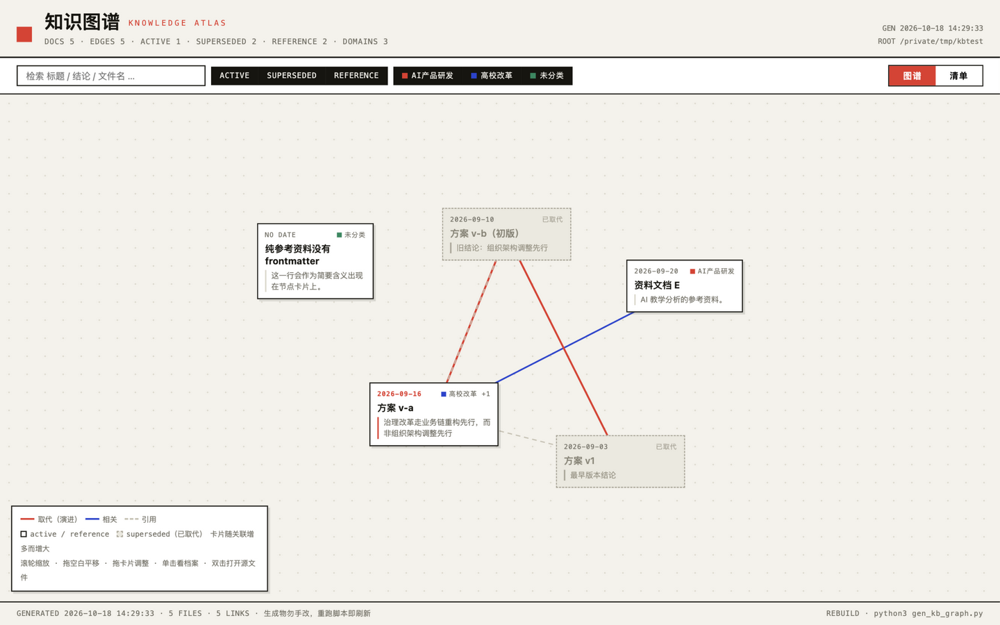
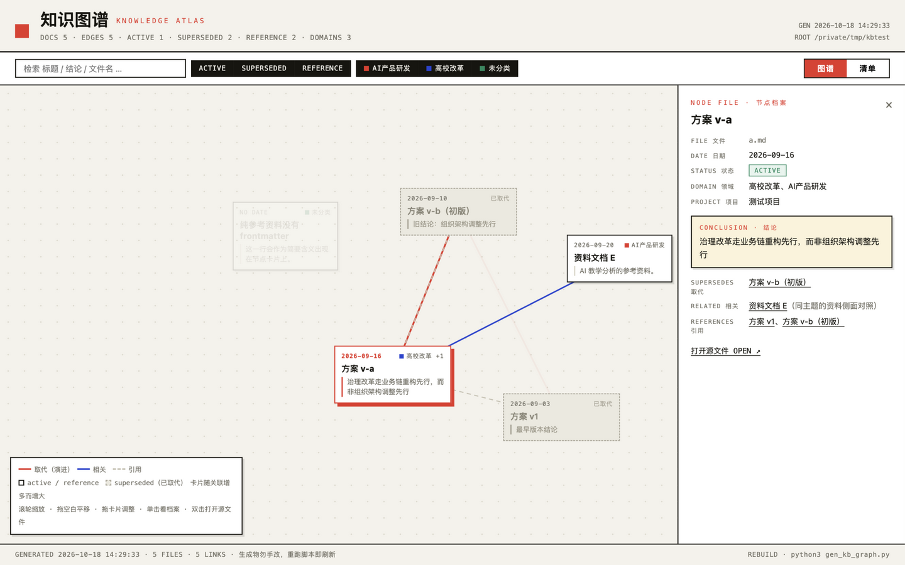
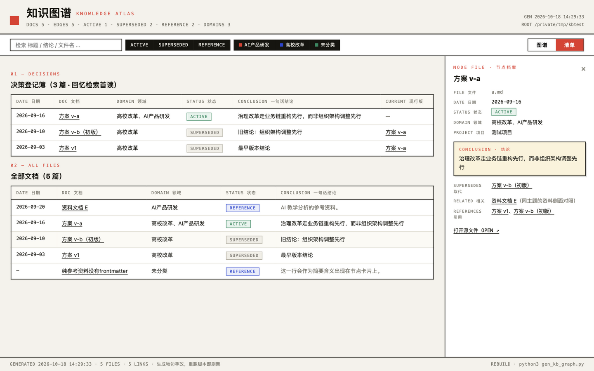

[English](README.md) | **简体中文**

# Personal Knowledge Graph · 个人知识图谱

> Turn a folder of Markdown notes into a self-contained knowledge base with an interactive knowledge graph — file-based, zero services, works in any SKILL.md-capable agent (ZCode, Claude Code, …).



## What it does

- **Metadata layer** — drafts frontmatter for every doc: date, domain, status (`active / superseded / reference`), one-line conclusion.
- **Three relation types** — `supersedes` (evolution), `related` (semantic), `[[wikilinks]]` (citations), forming a time-aware graph of how your thinking evolved.
- **Rebuildable distilled layer** — decision registry, per-domain adjacency, machine-readable JSON, and a health report (missing metadata / broken links). Everything regenerates in seconds.
- **Single-file HTML atlas** — Swiss-archive styled interactive page: force graph with card nodes (title + one-line meaning), search, filters, detail panel, table view. No CDN, works offline.

| Node file · node detail | Table view |
|---|---|
|  |  |

## Install

```bash
git clone https://github.com/loletranga/Personal-Knowledge-Graph.git ~/.agents/skills/personal-knowledge-graph
```

> The target folder name matters: it must match the skill `name` in `SKILL.md` (`personal-knowledge-graph`), so keep the destination path as-is.

Any agent that discovers `SKILL.md` (ZCode, Claude Code, …) will pick it up automatically.

## Usage

Just talk to your agent:

| You say | Mode |
|---|---|
| "Build a knowledge base from ~/notes" | Build |
| "Update my knowledge base" | Incremental update |
| "Recall my past thinking on X" | Decision-time recall |

Or rebuild the artifacts manually:

```bash
python3 gen_kb_graph.py <knowledge-base-folder> [--output graph] [--ignore "books,old"] [--no-html]
```

## How it works

1. **Your Markdown is the single source of truth.** The agent only adds frontmatter and `[[links]]` to your files; everything in `graph/` is regenerable.
2. **AI drafts, you confirm.** Metadata and relation suggestions are shown as samples/checklists before anything is written.
3. **No services required.** Pure stdlib script + one HTML file; scales comfortably to ~500 docs, after which the frontmatter + links migrate cleanly to LightRAG/Neo4j.

## Layout

```
personal-knowledge-graph/
├── SKILL.md               # agent workflow
├── references/schema.md   # full spec (fields / edges / output templates)
├── scripts/gen_kb_graph.py# graph builder (stdlib only)
└── assets/                # screenshots
```

## License

[MIT](LICENSE)
